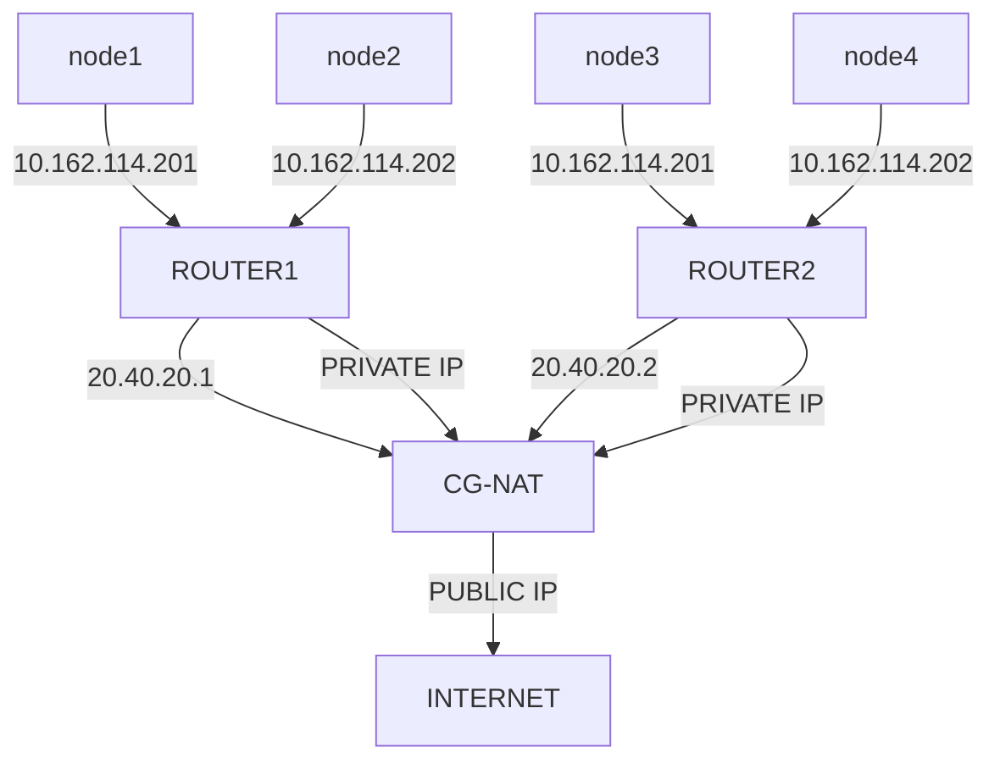

# Esborrany sobre el Projecte

### Context del projecte

Es crearà una eina per poder fer monitoratge d'equips que estiguin sota d'un CG-NAT, es resoldrà el problema de què els CG-NAT

no tenen cap manera tradicional per poder tenir ports oberts per a serveis o shells disponibles en xarxa que siguin disponibles des de 

Una xarxa pública diferent, ja que té una forma de xarxa lògica d'aquesta manera.



### Abast del projecte

Es tindrà en compte en la creació del projecte, els usuaris que necessiten el servei de monitoratge (els clients), la forma de la xarxa de forma lògica, s'intentarà posar en practica, el servidor privat en xarxa per poder establir la xarxa, els dispositius Raspberry per inicialitzar la connexió.

### Diagrama de Projecte

Els agents en el projecte són els següents: 

1. Xarxa

 * Tècnic - Amb el seu portàtil es podrà connectar en el VPS. 

 * WireGuard pel admin - És el túnel del tècnic fins al VPS. 

 * WireGuard pel client - És el túnel que tindrà cada client. 

 * FireWall - Per tindre un mínim de seguretat en la connexió, per només permetre la connexió a autoritzats.

 * Passarel·la - Serà la Raspberry en casa del client.

 * PC del client - On rebrà l'accés.

 * VPS -  El servidor privat que tindrem, on resideix, WireGuard (els túnels), firewall, la base de dades, el reconciliador de peticions de la web amb la bdd, i possiblement el monitoratge de connexions, memòries...

 > S'utilitzarà el VPS de forma simulada, també hauria de simular el portail web per les peticions del reconciliador per la base de dades.

2. Gestió

 * Portal web - On el tècnic demana les sessions.

 * Base de dades - On es guarden els clients, sessions...

 * Reconciliador - Compara el que té la bdd amb el que tenim posat.

 > S'està pensat utilitzar Python de forma molt bàsica per crear el reconciliador.

 * Monitoratge - Avisa si algun node falla.

3. Serveis

 * Web pública - Presenta el servei del tècnic.

4. Simulació

 * Proxmox serà l'hipervisor que usaré per crear xarxes internes, els hosts, els routers, ja que és molt més avançat que VirtualBox, i té moltes més funcionalitats que ens permetran simular-ho. 

```mermaid

flowchart LR

    T[Técnic] -->|Bridge| V[VPS]

    VPS -->|Bridge| P[Pasarela client]

    P --> PC[PC client]

    VPS --> Portal[Portal web]

    VPS --> DB[(BD)]

    VPS --> FW[Firewall]

    WPub[Web] --> DB

´´

