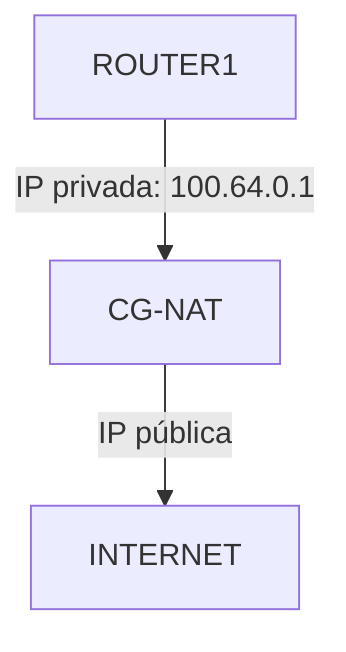
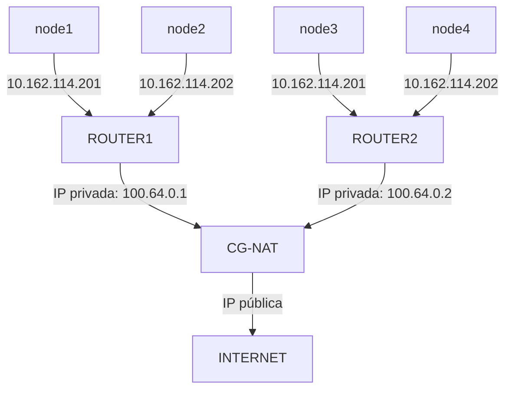
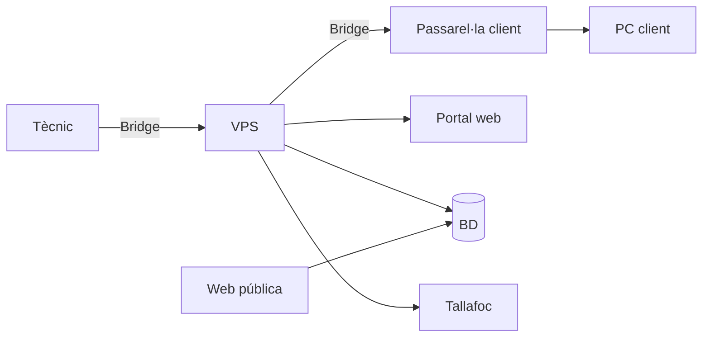

# [RBridge](https://github.com/Afix-MAB/RBridge)

### Context del projecte

En els darrers anys, molts proveïdors d'accés a Internet (ISP) han adoptat el CG-NAT (Carrier-grade NAT). Amb aquesta tècnica, els routers dels clients no reben una IP pública pròpia, sinó que molts d'ells en comparteixen una de sola.

**Quin problema té?**

El CG-NAT és un NAT gestionat per l'operador: dona al router del client una IP privada (normalment del rang 100.64.0.0/10) i tots els clients surten a Internet a través d'una mateixa IP pública. Així s'estalvien adreces públiques, un recurs escàs a causa de l'esgotament de les adreces IPv4.

Per a un usuari normal, això no suposa cap problema: pot navegar per Internet sense limitacions. El problema real apareix quan un servei tècnic remot necessita accedir a la xarxa del client. Tradicionalment, això es feia amb la IP pública del router, obrint un port o creant un túnel directe cap a la xarxa del client. Amb CG-NAT, el router no té IP pública pròpia i no és possible connectar-s'hi de manera tradicional.

**Quina solució hi ha?**

La nostra startup crearà una eina de monitoratge i accés remot per a equips que es troben darrere d'un CG-NAT, i així se solucionarà el problema d'accessibilitat als nodes interns. Al diagrama es pot veure que la IP pública pertany al CG-NAT, i que això és el que provoca la restricció.

### Abast del projecte

En la creació del projecte es tindran en compte:

- Els usuaris que necessiten el servei de monitoratge (els clients).
- La forma de la xarxa lògica, que s'intentarà portar a la pràctica.
- El servidor privat (VPS) en xarxa, per poder establir la connexió.
- Els dispositius Raspberry Pi, que inicialitzaran el túnel.

### Diagrama del projecte

**Els elements del projecte són els següents:**

**1. Xarxa**

- Tècnic - Amb el seu portàtil es podrà connectar al VPS.
- WireGuard de l'administrador - És el túnel del tècnic fins al VPS.
- WireGuard del client - És el túnel que tindrà cada client.
- Tallafoc (firewall) - Aporta un mínim de seguretat a la connexió, ja que només permet connexions autoritzades.
- Passarel·la - Serà la Raspberry Pi a casa del client.
- PC del client - L'equip al qual s'accedeix.
- VPS - El servidor privat on resideixen WireGuard (els túnels), el tallafoc, la base de dades, el reconciliador de peticions de la web amb la base de dades i, possiblement, el monitoratge de connexions, memòria, etc.

> El VPS s'utilitzarà de forma simulada. També caldrà simular el portal web per a les peticions del reconciliador a la base de dades.

**2. Gestió**

- Portal web - On el tècnic demana les sessions.
- Base de dades - On es guarden els clients, les sessions, etc.
- Reconciliador - Compara l'estat de la base de dades amb el que hi ha configurat realment.

> Es pensa utilitzar Python, de forma molt bàsica, per crear el reconciliador.

- Monitoratge - Avisa si algun node falla.

**3. Serveis**

- Web pública - Presenta el servei del tècnic.

**4. Simulació**

- Proxmox serà l'hipervisor que utilitzarem per crear xarxes internes, hosts i routers. És molt més avançat que VirtualBox i té moltes més funcionalitats que ens permetran simular el sistema.

